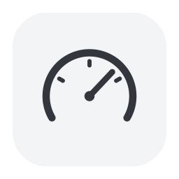
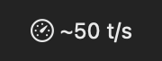
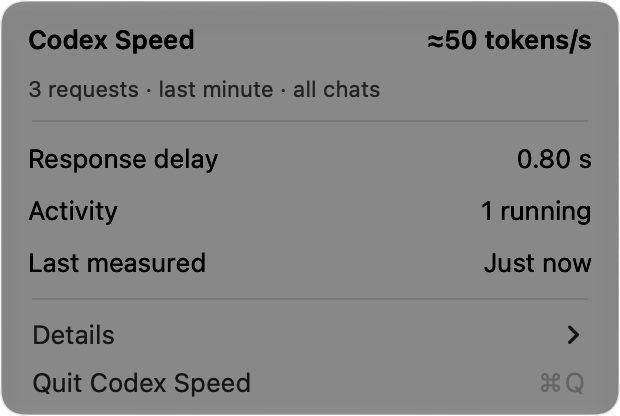

# Codex Speed Lite

[English](README.md) | **简体中文**

一个轻量的 macOS 菜单栏应用，用于查看 Codex 的请求吞吐率、响应延迟和运行状态。技术信息收在 **Details（详细信息）** 中。

## 界面预览





*截图使用演示数据，不包含私人使用记录。显示的是请求吞吐率，并非纯粹的模型生成速度。*

## 环境要求

- Apple Silicon Mac，macOS 14 或更新版本
- Python 3.11 或更新版本
- Xcode 命令行工具（`xcode-select --install`）
- 已通过 ChatGPT 账号登录 Codex

## 安装

请将项目放在以下位置，应用需要通过这个路径找到辅助程序：

```sh
git clone https://github.com/saslifat-gif/codex-speed-lite.git ~/.local/src/codex-speed-lite
cd ~/.local/src/codex-speed-lite
python3 -m venv .venv
.venv/bin/python -m pip install -r requirements.txt
zsh build.sh
mkdir -p ~/Applications
ditto "build/Codex Speed Lite.app" "$HOME/Applications/Codex Speed Lite.app"
open "$HOME/Applications/Codex Speed Lite.app"
```

如果已有菜单栏应用在运行，请先退出，再替换应用文件。

## 开始监测

在项目目录中运行：

```sh
.venv/bin/python control.py enable
```

等待当前任务完成后，重启 Codex 的后台服务。仅关闭窗口不一定会停止该服务。随后正常发送一条消息，即可获得首次测量结果。

## 停止监测

选择 **Details → Restore Direct Connection…（恢复直接连接）**，待当前工作结束后重启 Codex。

退出菜单栏应用只会关闭显示界面；本地转发服务仍会运行，避免中断正在进行的请求。

## 速度如何计算

统计所有被监测对话中，最近一分钟内完成的请求：

**输出 token 总数 ÷ 请求耗时总和**

其中包含推理以及 API／网络等待时间，但不包含本地工具执行时间。它**不是纯粹的模型 token 生成速度**。失败或缺少数据的样本会被跳过，不会估算补齐。

## 隐私

辅助程序在本机运行，将请求转发到原有的 ChatGPT 服务。它只保留测量元数据，不保存提示词、生成文本或登录凭据。可通过 **Details → Open History…（打开历史记录）** 查看本地记录；这些记录不会上传到 GitHub。程序不会额外发起 AI 请求。

## 测试

```sh
.venv/bin/python -m unittest discover -v
zsh build.sh
```
